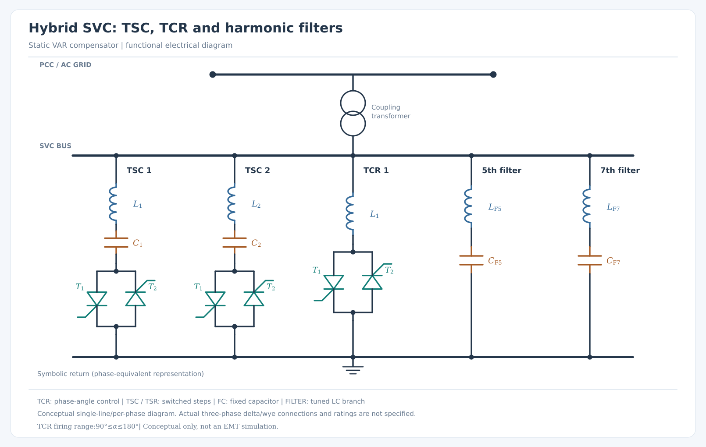

# FACTS SVC — modular Python circuit diagrams

A reusable Python package that draws **Static VAR Compensator (SVC)** circuits as layered, editable SVGs. It focuses on the electrical topology of TCRs, TSCs, fixed capacitors, tuned harmonic filters and antiparallel SCR pairs.



## Installation

Requires Python 3.10+. No third-party dependency is required to generate SVGs.

```bash
python -m pip install -e .
```

Optional additions: `python -m pip install -e ".[schemdraw,png]"`. When installed, Schemdraw supplies the native SCR vector primitives; CairoSVG enables PNG export.

## Quick start

```bash
# Generate all six built-in SVC designs as SVGs
python -m facts_svc --all --output-dir output

# Generate an FC-TCR diagram
facts-svc --preset fc-tcr --output-dir output

# Render a JSON-defined custom SVC
facts-svc --config examples/hybrid.json --output-dir output

# Generate SVG and PNG previews
facts-svc --preset hybrid --format both --output-dir output

# List presets
facts-svc --list-presets

# Skip the coupling transformer symbol
facts-svc --preset tsc-tcr --no-transformer --output-dir output
```

The renderer creates an SVG for each selected configuration and an accompanying `manifest.json`. By default, generated output is placed in the ignored `output/` directory. Pre-rendered, versioned SVG gallery examples are under [`examples/gallery`](examples/gallery).

## Available topologies

| Preset | Content |
| --- | --- |
| `tcr-only` | Single thyristor-controlled reactor |
| `fc-tcr` | Fixed capacitor and phase-controlled reactor |
| `tsc-tcr` | Switched capacitor and controlled reactor |
| `hybrid` | Two TSC banks, TCR, fifth- and seventh-order harmonic filters |
| `multi-tsc` | Three independently switched TSC banks and TCR |
| `tsr-fc` | Switched reactor and fixed capacitor |

Each TCR/TSR and TSC includes a pair of individually drawn, **oppositely directed SCR symbols** sharing upper and lower nodes. The TSC includes a small series reactor. Filters are shown as *series* inductor-capacitor branches in parallel with the SVC bus, not as a parallel L/C pair.

## Python API

```python
from facts_svc import Branch, BranchKind, SVCConfig, render_svg

svc = SVCConfig(
    title="My SVC teaching schematic",
    branches=(
        Branch("TSC 1", BranchKind.TSC),
        Branch("TCR 1", BranchKind.TCR),
        Branch("5th filter", BranchKind.FILTER, harmonic_order=5),
    ),
)
render_svg(svc, "output/my-svc.svg")
```

Custom configurations use `title`, `transformer` (boolean), and a `branches` array; see [`examples/hybrid.json`](examples/hybrid.json).

## Electrical interpretation

This is a **conceptual single-line/per-phase equivalent**, not an EMT simulation or a detailed three-phase terminal diagram. The common return is symbolic and **does not specify whether an actual plant uses delta, grounded-wye or ungrounded-wye banks**. The transformer symbol does not set turns ratio or impedance. TCR angle `α` is annotated for conceptual 90–180° phase control; TSC/TSR operate by switched steps. Components have no implied electrical ratings.

The drawing is made from editable SVG shapes and text, organized into layers for Inkscape. Scalar variables (including Greek letters) are italic; units and descriptive indices are upright; matrix names are reserved for bold upright notation.

## Tests

```bash
python -m unittest discover -s tests -v
```

The test suite validates models, SVG readability, valve counts, pair orientation and glyph typography. See [`docs/architecture.md`](docs/architecture.md) for design boundaries and the future common FACTS drawing library, and [`PROMPT.md`](PROMPT.md) for the development specification.

## Relationship to prior work

The SVG component and text architecture adapts patterns from the same author's [`three-phase-scr-rectifier-visualizer`](https://github.com/angelohafner/three-phase-scr-rectifier-visualizer), in particular `rectifier_art.py`'s Schemdraw SCR geometry approach. The new package is completely standalone and does not import the other repository.
